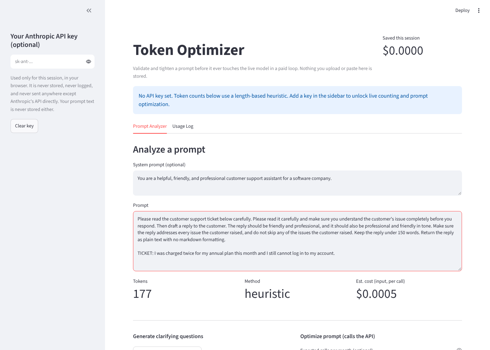
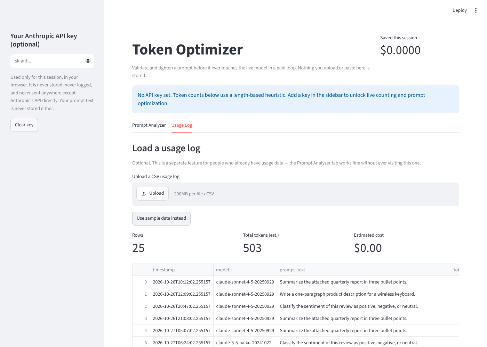

# LLM Token Optimizer

**Validate and tighten Claude API prompts before they run in a paid loop, with token and cost impact shown per call**

Teams iterate on prompts by running them against the live model, reading the output, tweaking, and running again. Every round costs money, and nothing tells them whether the prompt is bloated before it ships. This tool sits before production: paste a prompt, see what it costs per call, get a tightened version with every change listed, and confirm nothing important was lost.

**Source code is private. Live demo available on request.** Shipped to pilot customers in July 2026.

---

## The problem

- **Prompt iteration burns money.** Trial-and-error against the live API is the default way prompts get written.
- **Existing tools come too late.** LLM gateways and observability platforms are useful, but they need production traffic routed through them first. They cannot help before anything ships.
- **Most teams have no logging at all at the prompt stage.** The primary user has a prompt in a text file, not a usage pipeline.

## What it does

**Prompt Analyzer (the main flow, works from a pasted prompt alone)**
- Counts tokens and estimates input cost per call: exact counts through the API's token-counting endpoint with a key, a length-based estimate (about 4 characters per token) without one
- Generates up to five clarifying questions that expose ambiguity or missing constraints
- Rewrites the prompt to use fewer tokens, with short tags summarizing what changed
- Shows original vs optimized tokens, cost per call, and percent reduction
- Runs a second model pass that checks whether constraints, output-format instructions, and examples survived the rewrite. It is best-effort: if the check cannot be parsed, the result is treated as unconfirmed and the user is told to review the rewrite
- Projects monthly savings only if the user enters an expected call volume, and labels it as a projection

**Usage Log (optional, independent)**
- Upload a CSV usage log, or use sample data
- Fills in missing token counts and estimates total input cost

## Design decisions

| Decision | Why | Tradeoff |
|---|---|---|
| Bring your own key, session only | Users will not paste proprietary prompts into a tool that stores their key or text | No saved history; every session starts clean |
| No database, no file writes | Nothing to breach, nothing to retain | No trends across sessions |
| Works with no key at all | Zero-setup first run: a length-based heuristic estimates tokens | Heuristic counts are approximate; live counting needs a key |
| Savings shown per call by default | Without real volume, a monthly number would be invented | Smaller-looking numbers until the user supplies volume |
| Intent-preservation check after every rewrite | A shorter prompt that drops a constraint is worse, not cheaper | Flags some rewrites for manual review |
| Prompt flow never depends on the log flow | Most users have no logs at the prompt stage | Two separate features to maintain |
| Optional shared passcode for pilots | Controls who can reach a pilot link | Explicitly not authentication or data separation |
| Anonymous usage analytics | Measures which features deliver value | Only counts, flags, and dollar figures; never prompt text, file contents, or keys; off when unconfigured |

## Data handling

- The API key is passed explicitly to each call, used only for the current session, and sent only to Anthropic's API. It is never stored, logged, or included in error messages or exports.
- Prompts and uploaded logs are processed in memory for the session and never written to disk or a database.
- Analytics events carry a random per-session ID and aggregate figures only. The full event list is defined in one module and auditable.

## Known limitations

- Savings are input-side only: they price the prompt text, not the model's response.
- Usage Log cost estimates price every row at the default model's input rate, even rows that used a different model.
- Without a key, token counts are approximate.
- Model pricing is a static table and must be checked against current list prices.

## What it deliberately does not do

- No accounts or login
- No persistence of prompts, logs, or results after the session
- No scheduled ingestion or alerting
- No historical trend tracking
- No saved prompt library

## Stack

Python, Streamlit, Anthropic API (bring your own key), pandas, optional anonymous analytics.
